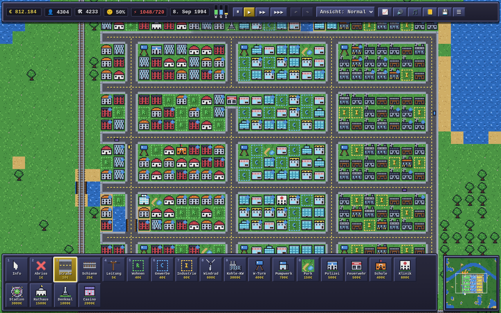
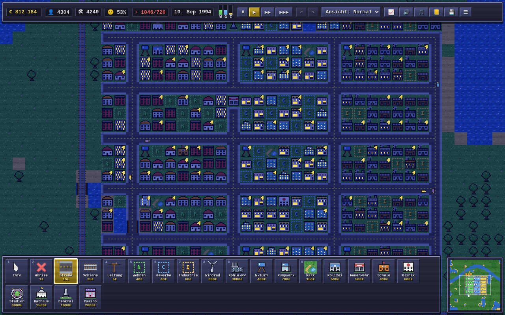
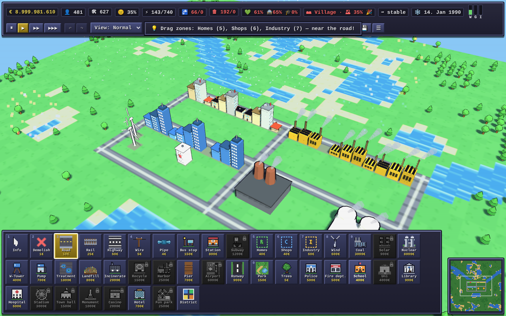
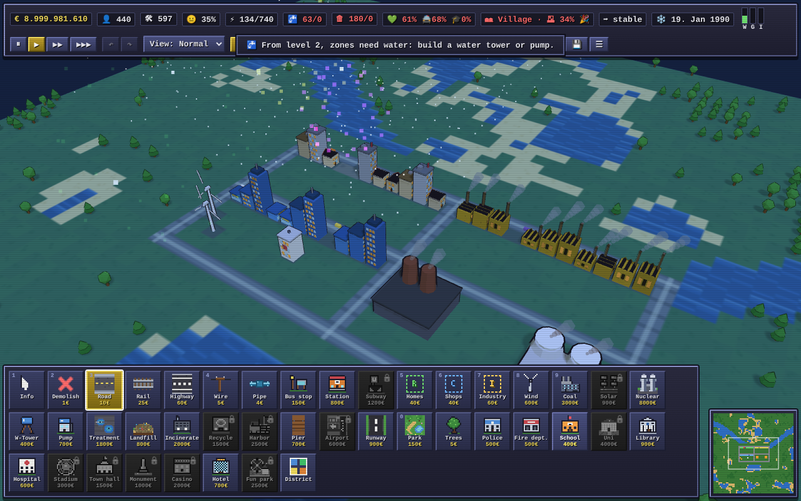
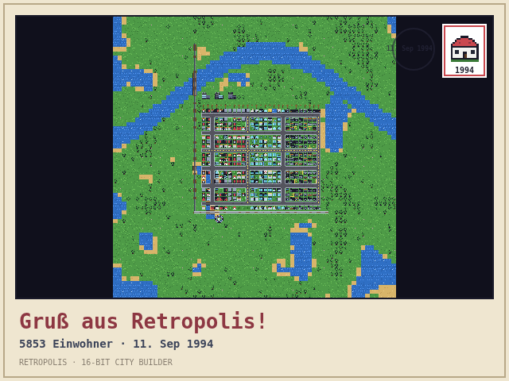

# 🏙 RETROPOLIS — 16-Bit City Builder

Ein retro-inspiriertes City-Building-Spiel im Stil der 16-Bit-Ära (SNES), komplett
im Browser spielbar und in einem Docker-Container ausgeliefert.



Alle Texturen sind **selbst entworfene Pixel-Art**, die zur Laufzeit im Code erzeugt
wird (ASCII-Pixelart + prozedurale Kacheln) — es gibt keinerlei externe Assets
oder Build-Schritte. Auch die Chiptune-Musik und alle Soundeffekte werden live per
WebAudio synthetisiert.



## 🧊 Zwei Ansichten: 2D-Pixel & 3D-Comic

Über den **🧊-Knopf** (oben) wechselst du jederzeit zwischen der klassischen
**2D-Pixel-Ansicht** und einer **3D-Comic-Ansicht** (cel-schattiert, mit kräftigen
schwarzen Umrissen und weichen Schatten). Steuerung in 3D: **Rechtsklick-Ziehen
dreht** die Kamera, **Shift+Ziehen schwenkt**, **Mausrad zoomt** — gebaut wird wie
gewohnt per Linksklick (exakte Kachel per Raycast). Three.js liegt **lokal** im
Repo (`web/js/vendor/`), der Container läuft also ohne Internet und ohne Build-Schritt.

**Detailgrad à la OpenTTD.** Die 3D-Welt ist bewusst kleinteilig gebaut:

- **Prozedurale, mehrteilige Gebäude** statt bunter Klötze — jedes aus Wänden,
  Dach, Fenstern und Extras zusammengesetzt (Vertex-Farben je Bauteil):
  - **Wohnen** wächst vom Einfamilienhaus mit Spitzdach, Tür und Schornstein über
    das Reihenhaus bis zum **Hochhaus** mit Fensterreihen und Dachaufbauten.
  - **Gewerbe** reicht vom Ladengeschäft mit Schaufenster & Markise bis zum
    gläsernen **Büroturm**.
  - **Industrie** bekommt das klassische **Sägezahndach mit Schornstein und Tanks**.
  - Eigene Modelle u. a. für **Kohle-KW** (Schlote), **Kernkraft** (Kühltürme),
    **Windrad** (Mast + Rotor), **Wasserturm**, **Krankenhaus** (Kreuz + Helipad),
    **Freizeitpark** (Riesenrad), **Stadion**, **Hafen** (Kran + Container),
    **Flughafen** (Tower), **Denkmal**, **Rathaus** (Turm) u. v. m.
- **Detaillierter Boden** (adaptiv hochaufgelöste Textur): Gras mit Büscheln und
  Farbvariation, Sand mit Körnung, **Wasser mit Wellen und hellem Küstensaum**,
  Straßen mit Mittel-/Randmarkierung (Autobahn gelb gestrichelt), Schienen mit
  **Schwellen und Schienensträngen**.
- **Drei Baumtypen** (Nadel-, Laubbaum, Busch) in zufälliger Größe und Drehung,
  dazu weiche Schlagschatten und ein leichter Tiefen-Nebel am Horizont.

Tag/Nacht färbt Himmel, Sonne und Umgebungslicht um. Auf sehr großen Karten
werden Texturauflösung und Schatten automatisch gedrosselt.



## 🆕 20 neue Features



**Simulation & Stadtpolitik**
1. **🌳 Bäume pflanzen** — neues Werkzeug (5 €/Baum, malbar). Stadtbäume senken den Smog und
   **heben den Landwert** der Nachbarfelder.
2. **📚 Stadtbibliothek** (ab 300 Einw.) — hebt das Bildungsniveau (gedeckelt) und ist eine kleine Attraktion.
3. **🏘 Stadtränge** — Siedlung → Dorf → Kleinstadt → Stadt → Großstadt → Metropole →
   Weltmetropole, mit Aufstiegsmeldung und Anzeige in der Statusleiste.
4. **🗳 Zustimmung & Bürgermeisterwahl** — die Zustimmung (Laune, Steuern, Kriminalität,
   Finanzlage) steht im HUD; alle 4 Jahre wird gewählt: Wiederwahl bringt einen Bonus, bei
   Abwahl senkt die neue Mehrheit die Steuern.
5. **🎉 Stadtfest** — im Budget-Panel buchbar: 3 Monate mehr Laune und Tourismus.
6. **🚗 Verordnung Tempo 30** — −25 % Straßen-Smog, Gewerbe minimal gebremst.
7. **☀️ Verordnung Solarförderung** — +30 % Solarstrom gegen feste Monatskosten.
8. **💶 Fördermittel vom Land** — zufällige Zuschüsse für wachsende Städte.
9. **🌋 Erdbeben** — neue Katastrophe: Gebäude stürzen ein, Brände brechen aus.
10. **📅 Jahresrückblick** — jeden Januar Bilanz: Einwohner- und Kassenentwicklung.
11. **📊 Budget-Prognose** — das erwartete Monatsergebnis im Budget-Panel und als Tooltip
    auf der Kasse (exakt dieselbe Rechnung wie die echte Abrechnung).

**Lebendige 3D-Welt**

12. **💡 Nachtlichter** — nachts leuchtet ein Teil der Fenster warm auf.
13. **🌀 Drehende Windrad-Rotoren**.
14. **💨 Rauchfahnen** aus Fabrikschloten, Kohle-KW, Müllverbrennung und Kühltürmen.
15. **🚌 Fahrzeuge in 3D** — Autos, ÖPNV-Busse und Züge in Linienfarbe fahren durch die Stadt.
16. **❄️ Wetter in 3D** — Schneefall im Winter, Regenschauer im Frühling/Herbst.
17. **🔥 Katastrophen sichtbar** — flackernde Flammen, Hochwasser, Tornado-Trichter und UFO;
    beim Stadtfest steigt **Feuerwerk** auf.
18. **🎥 Kinomodus & Kamera-Steuerung** — Kamera kreist automatisch (🎥 / `K`), `Q`/`E` drehen,
    `WASD` schwenken, `R` setzt zurück.

**Bedienung**

19. **⌨ Tastenkürzel-Hilfe** — `?` / `F1` oder ❓ zeigt alle Shortcuts.
20. **🎯 Kamerafahrten in 3D** — Doppelklick fährt weich auf eine Stelle zu; Minimap-Klicks und
    Sprünge aus Ereignis-/Bezirks-Panels zentrieren auch die 3D-Kamera.

Alle Zufallsereignisse (Fördermittel, Erdbeben) sind **deterministisch pro Seed** und lassen
bestehende Zufallsfolgen unverändert; Stadtfest und Jahresbilanz werden mitgespeichert
(Save/Load bleibt bitgenau).

## 🚀 Schnellstart

```bash
docker compose up --build
```

Dann im Browser öffnen: **http://localhost:8080**

Alternativ ohne Compose:

```bash
docker build -t retropolis .
docker run -p 8080:80 retropolis
```

## 🎮 So wird gespielt

Du bist Bürgermeister:in. Baue Straßen und Kraftwerke, weise Zonen aus und
bring deine Stadt vom Dorf zur Metropole.

1. **Straßen (3)** bauen — sie erschließen Zonen und leiten Strom.
2. **Windrad (8)** oder **Kohlekraftwerk (9)** neben dem Straßennetz platzieren.
3. **Zonen ziehen**: Wohnen (5), Gewerbe (6), Industrie (7) — per Drag als Rechteck.
4. Zonen mit **Strom** und einer **Straße/Schiene im Umkreis von 3 Feldern**
   entwickeln sich über 4 Stufen — vom Häuschen zum Hochhaus.
5. **Wasser**: Ab Stufe 2 brauchen Zonen Wasserversorgung. Wasserturm bauen
   (oder Pumpwerk ans Ufer setzen) und mit **Wasserleitungen** ans Netz aus
   Straßen und Gebäuden anschließen — genau wie beim Strom.
6. Mit **Polizei, Feuerwehr, Schule, Krankenhaus, Parks** Zufriedenheit und
   **Landwert** steigern — bei hohem Landwert entstehen Luxus-Hochhäuser.
7. Meilensteine schalten **Rathaus, Stadion, Denkmal und Casino** frei.
8. **Tourismus als Geldquelle**: **Freizeitpark** & Co. als Attraktionen bauen,
   **Hotels** daneben setzen und mit einer Straße/Schiene zur Außenwelt verbinden —
   die Touristen bringen Monat für Monat Geld in die Kasse.

### Steuerung

| Eingabe | Aktion |
|---|---|
| Linksklick / Ziehen | Bauen (Straßen/Schienen/Leitungen als Linie, Zonen als Rechteck) |
| Rechtsklick / Ziehen | Karte verschieben |
| Mausrad / `+` `-` | Zoom (1×–4×) |
| `1`–`0` | Werkzeuge wählen |
| `Strg+Z` / `Strg+Y` | Rückgängig / Wiederholen |
| `ESC` | Info-Werkzeug (Kachel abfragen) |
| Leertaste | Pause |
| `WASD` / Pfeiltasten | Karte verschieben |
| Touch | Tippen = bauen, Ziehen = verschieben, Pinch = Zoom |

### Simulation

- **RCI-Nachfrage**: Wohnen, Gewerbe und Industrie beeinflussen sich gegenseitig
  (Jobs ⇄ Einwohner), angezeigt als Balken in der Statusleiste.
- **Stromnetz**: Kraftwerke speisen ein Netz aus Straßen, Schienen, Stromleitungen
  und Gebäuden. Zu wenig Erzeugung ⇒ Brownouts.
- **Wassernetz**: Wassertürme und Pumpwerke (am Ufer) speisen ein eigenes Netz aus
  **Wasserleitungen**, Straßen, Schienen und Gebäuden — mit eigener Kapazität. Reicht
  das Angebot nicht (Anzeige `🚰 Bedarf/Angebot`), fallen Zonen trocken und wachsen
  nicht über Stufe 2. Stromleitungen leiten kein Wasser; Wasserleitungen leiten
  keinen Strom. Beide können als Unterwasser-„Brücke“ verlegt werden (×3 Kosten).
- **Pendler-Wegfindung**: Wohnzonen pendeln über das echte Straßen-/Schienennetz
  zum nächsten Arbeitsplatz (Multi-Source-BFS). Der Pendlerfluss erzeugt den
  Verkehr auf genau den Straßen, die wirklich benutzt werden; Schienen schlucken
  Verkehr. Getrennte Netze ohne Jobs bzw. Kunden wachsen nicht — Ursache statt
  Radius-Näherung.
- **Wachstums-Diagnose**: Das Info-Werkzeug zeigt pro Zone alle Wachstumsfaktoren
  mit ✓/✗ (Strom, Anbindung, Netzverbindung, Nachfrage, Wasser, Umwelt, Stau,
  Landwert, Steuern) — nie wieder rätseln, warum nichts wächst.
- **Brücken**: Straßen, Schienen und Leitungen können Flüsse überqueren (3× Kosten).
- **🛣 Autobahn**: Hochleistungsstraße mit viel höherer Kapazität — nimmt Pendler
  auf, ohne zu verstopfen (deutlich weniger Stau als eine normale Straße), und
  liefert am Kartenrand ein Vielfaches an Export-Kapazität.
- **🗑 Müllentsorgung**: Wohn-, Gewerbe- und Industriezonen produzieren Müll.
  **Deponie** (Fläche, etwas Geruch) und **Müllverbrennung** (kompakt, mehr Smog)
  schaffen Entsorgungskapazität, der **Recyclinghof** (ab 1996) senkt das Aufkommen.
  Türmt sich der Müll (Anzeige `🗑 Aufkommen/Kapazität` im Budget), leidet die
  Zufriedenheit — analog zu Strom und Wasser ein Kapazitätssystem.
- **🚔 Kriminalität**: Steigt in dicht bebauten Vierteln mit schlechter
  Polizei-Abdeckung, drückt Landwert **und** Zufriedenheit und kann ganze Blocks
  verfallen lassen. Eigenes „Kriminalität“-Overlay; mehr Polizeiwachen wirken direkt.
- **🎓 Bildung → saubere Industrie**: Dauerhafte Schul-Abdeckung hebt das
  Bildungsniveau der Stadt. Gebildete Industrie verschmutzt weniger und schafft mehr
  Jobs (Hi-Tech-Wandel, ab dem Internet-Zeitalter 2000 stärker).
- **☢️ Kernkraftwerk**: Liefert enorm viel Strom (500) — aber Vorsicht: eine seltene
  **Kernschmelze** setzt die Umgebung in Brand und zerstört den Reaktor.
- **📜 Verordnungen**: Stadtweite Schalter im Budget-Panel mit monatlichen Kosten —
  Rauchmelderpflicht (weniger Brände), Recyclingpflicht (weniger Müll),
  Wirtschaftsförderung (mehr G/I-Nachfrage), Sparmaßnahmen (weniger Strom-/Wasser­bedarf)
  und Kulturprogramm (mehr Zufriedenheit).
- **💰 Ressort-Finanzierung**: Regler für Polizei, Feuerwehr, Schule, Gesundheit und
  Parks (50–150 %). Mehr Geld = bessere Abdeckung, weniger = billiger, aber mehr
  Kriminalität/Brände/Unzufriedenheit — das Budget-Panel wird zum Strategiewerkzeug.
- **🗓 Wetter & Jahreszeiten**: Der Winter (❄️) hebt den Strombedarf (Heizen), der
  Sommer (☀️) den Wasserbedarf und ist Tourismus-Hochsaison. Dazu sichtbarer Schnee
  im Winter und Regen im Frühling/Herbst.
- **💧 Wasserverschmutzung & Kläranlage**: Zieht ein Pumpwerk Wasser aus stark
  belastetem Gewässer, wird das Trinkwasser schlecht (Zufriedenheits-/Gesundheits­malus)
  — bis eine **Kläranlage** es reinigt.
- **🎓 Universität & Gesundheit**: Die Universität hebt das Bildungsniveau stadtweit
  im Eiltempo (und ist eine Attraktion). Ein **Gesundheitsindex** fasst Krankenhaus-
  Abdeckung, Verschmutzung und Wasserqualität zusammen.
- **☢️ Kernschmelze**, **🚢 Schiffe & ✈ Flugzeuge**, **👥 Einwohner-Panel** — siehe unten.
- **🗺️ Bezirke**: Male benannte Stadtbezirke auf die Karte und sieh pro Bezirk
  Einwohner, Landwert und Kriminalität — mit Sprung zum Bezirk.
- **🔔 Ereignis-Protokoll**: Alle Meldungen (Brände, Brownouts, Meilensteine, Erfolge)
  in einer Liste — ein Klick springt zum Ort des Geschehens.
- **🏆 Erfolge**: Zehn Sammelziele (erste 1.000 Einwohner, saubere Stadt, Reiseziel,
  Bildungshochburg, Metropole …) mit Geldbonus beim Freischalten.
- **🚏 ÖPNV mit Linienverwaltung**: Lege im Linien-Panel eigene Linien an
  (benennen, löschen). **Neue Stopps setzt du direkt mit dem Werkzeug**: Linie
  wählen und auf die Karte klicken — auf ein leeres Feld baut das Spiel die
  passende Haltestelle automatisch und fügt sie der Linie hinzu (ein Klick auf
  eine vorhandene Haltestelle übernimmt sie). Busse fahren über **Straßen und
  Autobahnen**, Züge über Schienen, U-Bahnen graben Tunnel — und verbinden sogar
  getrennte Stadtteile. Pendler steigen **automatisch** um, wenn die Linie schneller ist
  (echte Umsteige-Kanten in der Wegfindung): Das nimmt Autos von der Straße,
  verkürzt Arbeitswege und bringt Fahrgeld ein — gegen Betriebskosten je Linie
  und Stopp. Busse und Züge pendeln sichtbar auf ihren Routen, das
  „Linien“-Overlay zeigt das ganze Netz wie einen Liniennetzplan.
- **Landwert**: Wasserlage, Parks und Sicherheit steigern ihn; Verschmutzung und
  Stau drücken ihn. Hoher Landwert ⇒ Luxus-Gebäudevarianten und schnelleres Wachstum
  — **und mehr Steuereinnahmen**: Gut geplante, attraktive Viertel bringen pro Kopf
  deutlich mehr Geld (bis zu +30 % bei Spitzen-Landwert). Stadtplanung zahlt sich aus.
- **Budget & Kredite**: monatliche Steuern minus Unterhalt; bei Ebbe in der Kasse
  Kredite in 5.000-€-Schritten (1,5% Zins/Monat), jederzeit tilgbar.
- **Katastrophen**: Brände, **Tornados**, **Hochwasser** am Ufer — und
  gelegentlich ein **UFO** 👽 (alles abschaltbar).
- **Berater**: Berater-Charaktere mit Pixel-Porträts melden sich bei Geldnot,
  Stromausfall, Smog, fehlender Feuerwehr, Wasser- oder Müllproblemen,
  steigender Kriminalität und ungenutztem Tourismus-Potenzial.
- **Meilensteine**: Boni bei 100 / 500 / 1.500 / 2.500 / 4.000 Einwohnern
  inkl. Freischaltung der Belohnungsgebäude.
- **Außenwelt & Außenhandel**: Straßen und Schienen, die bis zum Kartenrand
  gebaut werden, verbinden die Stadt mit der Außenwelt (gelbe Pfeil-Marker).
  Industrie **braucht** eine solche Anbindung, um zu exportieren — die
  Exporterlöse hängen an der Kapazität (Straße < Autobahn < Schiene < **⚓ Hafen**
  am Wasser < **✈ Flughafen**) und tauchen als eigene Budget-Zeile auf. Der
  **Flughafen** (ab 1995) ist der stärkste Export- **und** Tourismus-Motor
  zugleich — bringt aber Fluglärm/Abgase, die den Landwert ringsum drücken.
- **Dynamische Großanlagen (Flughafen & Hafen)**: Beide starten als 2×2-Kern und
  lassen sich mit **Erweiterungskacheln** vergrößern, die wie Straßen gezogen
  werden und sich per Autotile zu einer durchgehenden Anlage verbinden:
  - **✈ Landebahn** (`runway`): schließt an Flughafen oder Landebahn an (auf Land),
    hebt Export-Kapazität **und** Tourismus-Attraktivität je Kachel.
  - **⚓ Pier** (`pier`): wird aufs Wasser gebaut und schließt an Hafen oder Pier
    an, hebt die Export-Kapazität je Kachel.
  So wächst die Kapazität mit der tatsächlich gebauten Fläche statt in festen
  Sprüngen. Das Info-Fenster zeigt den Zuwachs pro Landebahn/Pier an; der
  Flughafen muss dafür mit Strom versorgt sein.
- **Tourismus** 🧳: Ein eigener, laufender Einnahmestrom. **Attraktionen**
  (Freizeitpark, Stadion, Denkmal, Casino, Parks) locken Besucher an, **Hotels**
  beherbergen sie (Betten = Kapazität). Wie viele Touristen kommen, hängt an der
  Zufriedenheit, der Konjunktur und der Anbindung an die Außenwelt (Anreise). Je
  mehr Attraktionen + Hotels + zufriedene Stadt, desto mehr Geld fließt Monat für
  Monat — sichtbar als eigene Budget-Zeile und im Info-Fenster von Hotel/Park.
- **Konjunkturzyklus**: Die Wirtschaft schwankt deterministisch zwischen
  📈 Boom und 📉 Rezession (Anzeige in der Statusleiste) und bewegt Nachfrage
  wie Exportpreise. Boom-/Krisen-Meldungen landen in Zeitung und Toasts.
- **Kartengrößen bis 1024×1024**: von „Klein (48×48)“ bis „Kontinent“
  (>1 Million Kacheln) — dank LRU-Chunk-Cache, Multi-Source-BFS statt
  Radius-Scans und Sampling-Minimap flüssig spielbar (57 FPS im Test).

### Spielmodi

- **Freies Spiel** — klassisch, eigene Karte per Größe (48–96) und Seed mit Vorschau.
- **Sandbox** — unbegrenztes Geld, Katastrophen aus.
- **Szenarien** mit Sieg-/Niederlagen-Bedingungen:
  - *Wachstums-Sprint*: 1.000 Einwohner in 5 Jahren.
  - *Grüne Metropole*: 2.000 Einwohner + 55% Zufriedenheit ohne Kohlekraft in 10 Jahren.
  - *Die Pleite-Stadt*: Übernimm eine verschuldete Bestandsstadt und saniere sie.
  - *Tourismus-Insel*: 2.500 Einwohner + 60% Zufriedenheit in 12 Jahren — vom Tourismus leben.
  - *Metropole*: 5.000 Einwohner + 55% Zufriedenheit in 15 Jahren.

### Alleinstellungsmerkmale

- **Stadt als Link teilen**: Dank RLE-Kompression passt die ganze Stadt in eine
  URL (`…#city=…`, ~6 KB). Empfänger öffnet den Link — fertig. Kein Server,
  kein Account.
- **📟 RETRO-NET BBS**: Ein 90er-Mailbox-Terminal (mit Modem-Einwahlgeräusch!)
  zum Veröffentlichen und Einwählen von Stadt-Codes, mit lokaler Rekordliste
  und der Zeitung.
- **👥 Nachvollziehbare Bürger:innen**: Jedes bewohnte Haus hat einen
  deterministisch generierten Haushalt — Name, Alter, **Wohlstand** (aus dem
  Landwert), Arbeitsplatz, echter Pendelweg aus der Wegfindung und eine Laune,
  die den tatsächlichen Zustand widerspiegelt („…dauernd Stromausfall"). Das
  neue **Einwohner-Panel** (👥) zeigt Demografie (beschäftigt/arbeitslos,
  Bildung, Tourismus) plus eine Stichprobe echter Bürger:innen — ein Klick
  springt zu ihrem Zuhause. Wählt man ein Wohnhaus aus, zeichnet die Karte den
  **Pendelweg zum Arbeitsplatz** ein. Autos anklicken verrät, wer da fährt.
- **📰 Retropolis Kurier**: Zeitungs-Schlagzeilen aus echten Sim-Ereignissen
  („STAU-REKORD: Herta Kowalski pendelt 19 Felder").
- **Epochen**: Die Zeit verändert das Spiel — 1994 kommt die Solaranlage,
  1998 die CO₂-Abgabe auf Kohle, ab 2000 senken E-Autos (mit grünem Lämpchen)
  die Abgase, 2002 werden Solarmodule stärker.
- **📸 Foto-Modus**: Ein Klick rendert die Stadt als „Gruß aus …!"-Postkarte
  mit Briefmarke und Poststempel — als PNG teilbar.
- **Cheat-Codes wie früher**: `geld`, `ufo`, `sturm`, `disco` und der
  Konami-Code — aber die Statistik merkt sich, dass gemogelt wurde. 😈



### Moderne Features im Retro-Gewand

- Drag-Bau mit Live-Vorschau und Kostenanzeige, **Undo/Redo** (Strg+Z/Y)
- **Auslastungs-Anzeigen in der Statusleiste**: neben `⚡ Strom` und `🚰 Wasser`
  jetzt auch `🗑 Müll` (Aufkommen/Kapazität) und ein Wohlfahrts-Indikator
  `💚 Gesundheit 🚔 Kriminalität 🎓 Bildung` — bei Engpässen rot.
- Daten-Overlays: Strom, Wasser (Netzansicht versorgt/trocken), **Müll**, Verkehr, Landwert, Umwelt, Polizei,
  Feuerwehr, Bildung, Gesundheit, Freizeit, Kriminalität — Problemzonen zusätzlich
  **schraffiert** (farbenblind-tauglich)
- **Statistik-Panel** mit Verlaufsgraphen (Einwohner, Kasse, Zufriedenheit) und
  einem **Stadt-Dashboard**: alle Kennzahlen auf einen Blick (Beschäftigung,
  Strom, Wasser, Müll, Kriminalität, Bildung, Tourismus, Export, Anschlüsse) —
  Problemwerte rot hervorgehoben
- **Transparentes Info-Panel**: Jedes Gebäude erklärt in einem Satz, was es tut,
  und zeigt seinen konkreten Live-Beitrag (Stromabgabe, Wasserabgabe,
  Abdeckungsradius, Export-/Müllkapazität, Bedarf, Unterhalt)
- **🚢 Schiffe & ✈ Flugzeuge**: Frachtschiffe fahren sichtbar auf dem Wasser rund
  um die Häfen (in Fahrtrichtung gedreht, mit Bugwelle); an Flughäfen starten
  Verkehrsflugzeuge und ziehen mit Bodenschatten über die Karte
- **Tag/Nacht-Zyklus** mit leuchtenden Fenstern und Auto-Scheinwerfern
- **3 Save-Slots** mit Autosave, Export/Import als JSON-Datei
  (RLE-komprimiertes Format v4, lädt auch alte Spielstände)
- **Zweisprachig**: Deutsch/Englisch, automatisch erkannt, umschaltbar
- **Touch-optimiert**: größere Ziele, Pinch-Zoom, optionale Bau-Bestätigung
- Minimap, 3 Geschwindigkeiten + Pause, Meldungs-Toasts, Einsteiger-Tipps
- Animiertes Wasser, drehende Windräder, Rauch, fahrende Autos, Züge, Schiffe und Flugzeuge
- CRT-Scanline-Effekt (abschaltbar), **2 Chiptune-Songs** mit ruhigeren
  Nacht-Varianten, Ambient-Sound (Wasserrauschen, Verkehr), Lautstärkeregler

## 🗂 Projektstruktur

```
├── Dockerfile            # nginx:alpine, liefert web/ aus
├── docker-compose.yml    # Port 8080 → 80
├── nginx.conf
├── package.json          # npm test / benchmark / test:e2e
├── test/
│   ├── load-sim.js       # lädt die DOM-freie Simulation in Node
│   ├── unit.test.js      # RLE, Save v4 + Migration, Determinismus,
│   │                     #   Pendler-Konnektivität, Bau-Regeln, Kredite
│   ├── soak.test.js      # 10 Spieljahre Referenzstadt (Stabilität)
│   ├── benchmark.js      # Wachstumskurven nach Balancing-Änderungen
│   └── e2e.test.js       # Browser-Test (Playwright, eigener Static-Server)
└── web/
    ├── index.html        # UI-Gerüst (Statusleiste, Werkzeugleiste, Dialoge)
    ├── style.css         # SNES-inspiriertes UI, CRT-Effekt, Touch-Ziele
    └── js/
        ├── balance.js    # ALLE Tuning-Konstanten an einem Ort
        ├── i18n.js       # Deutsch/Englisch
        ├── sprites.js    # Pixel-Art-Engine: alle Texturen als Code, Nacht-Atlas
        ├── sim.js        # DOM-freie, deterministische Simulation: Terrain,
        │                 #   Strom, Wasser, Pendler-BFS/Verkehr, Landwert,
        │                 #   Budget/Kredite, Katastrophen, Szenarien, RLE-Saves
        ├── audio.js      # WebAudio-Chiptunes, Ambient, SFX
        └── main.js       # Chunk-Renderer, Eingabe, UI, Fahrzeuge, Tag/Nacht,
                          #   Undo/Redo, Berater, Diagnose, Statistik, Slots
```

Reines Vanilla-JavaScript (ES2020), keine Laufzeit-Abhängigkeiten, kein
Build-Schritt — der Container ist ein statischer nginx mit ~130 KB Spielcode.

**Rendering**: Statisches (Terrain, Gebäude, Straßen) wird in 16×16-Kachel-Chunks
vorgebacken und nur bei Änderungen neu gezeichnet; pro Frame laufen nur Wasser,
Feuer, Fahrzeuge, Symbole und Overlays — dadurch bleiben auch 96×96-Karten und
Mobilgeräte flüssig.

**Determinismus**: Gleicher Seed + gleiche Aktionen ⇒ exakt gleicher Verlauf
(durch Unit-Test abgesichert). Fahrzeuge und Musik sind rein kosmetisch und
davon ausgenommen.

## 🧪 Entwicklung & Tests

```bash
npm start              # lokaler Server ohne Docker (http-server)
npm test               # Unit- + Soak-Tests (reines Node, keine Dependencies)
npm run benchmark      # Wachstumskurven nach Änderungen an balance.js
npm run test:e2e       # Browser-E2E (benötigt Playwright + Chromium):
                       #   PLAYWRIGHT_PATH=… CHROMIUM_PATH=… npm run test:e2e
```

Alle Balancing-Werte liegen zentral in `web/js/balance.js`. Nach Änderungen
`npm run benchmark` ausführen und die Kurven vergleichen — der Benchmark hat
z. B. aufgedeckt, dass ein zerstörtes Einzel-Kraftwerk eine Stadt früher binnen
Tagen auslöschte (Verfallsrate inzwischen entschärft).
